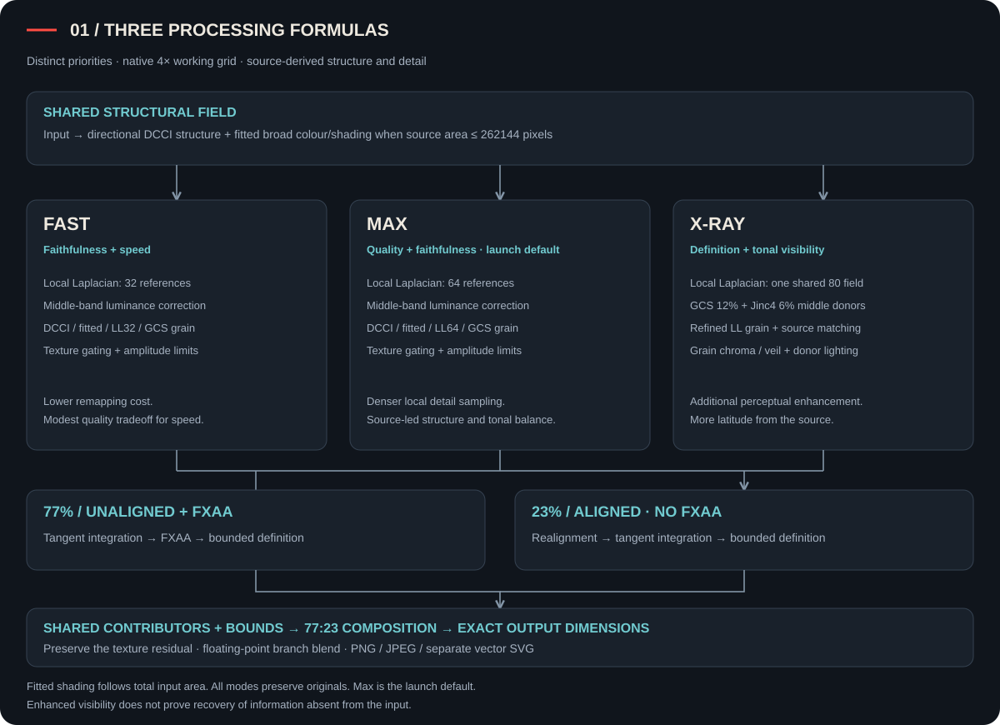
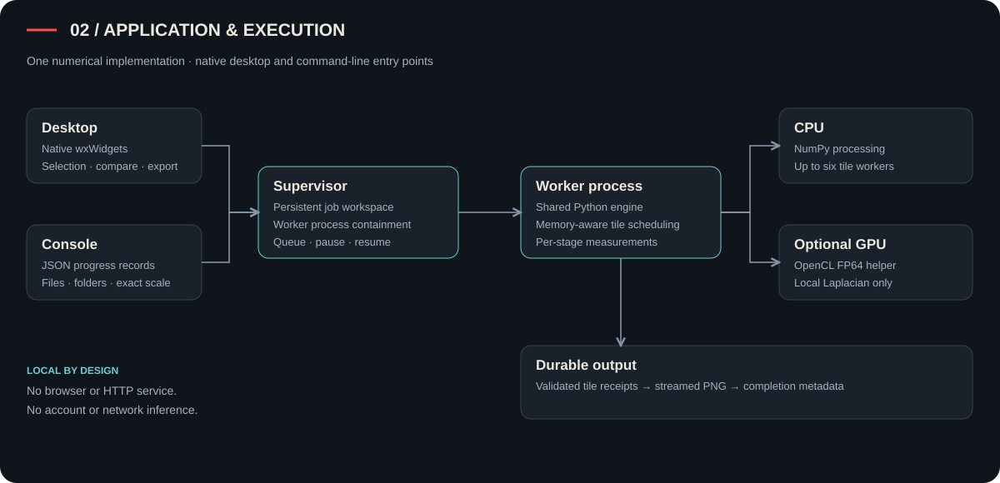
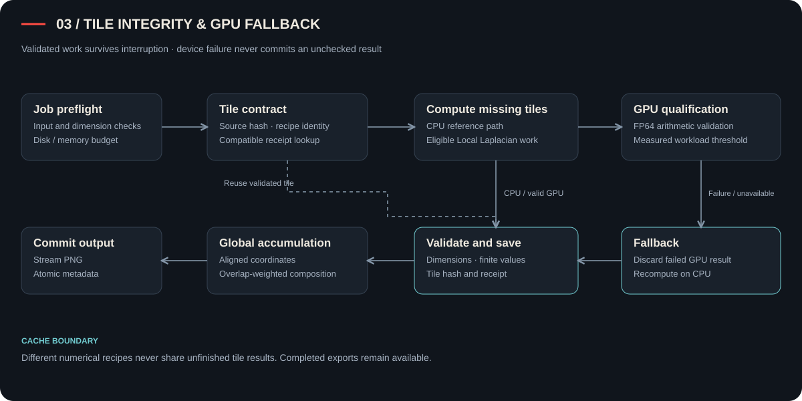

<p align="center"></p>
<h1 align="center">Untorn Engine</h1>
<p align="center"><strong>Untorn Image clarity to restore low-res images.</strong><br>Source-derived detail. Controlled tone. Local execution.</p>
<p align="center">Windows x64 · Native desktop · Fractional scaling · Python CLI</p>


Portable, deterministic image upscaling for Windows x64, engineered for clean edges and faithful detail from low-resolution images. Processing runs locally without AI models.

**Untorn Engine is a portable image upscaler built to make low-resolution images
clearer at useful output sizes.** It separates structure, broad shading,
middle-frequency detail and fine texture, giving each a defined processing role
and a bounded contribution to the result.

**Pipeline, directly:** **DCCI** establishes directional structure on a 4× grid;
**fitted colour/shading** stabilizes broad colour on eligible small inputs;
**Local Laplacian** resolves middle detail and supplies fine texture;
**GCS contour-stencil interpolation** adds a complementary grain donor.
**X-Ray** also uses bounded GCS/**Jinc4** middle-band corrections and internal
**translated/rotated source matching** for fine detail. Grain gates and local
limits constrain the combined residual. **77% unaligned FXAA + 23% aligned
without FXAA** treats the structural field while retaining that texture residual.
Pixel-centred sampling and adaptive **DCCI** deliver the requested dimensions;
**Pillow** handles raster I/O, **wxWidgets** supplies the desktop, and the **Python
CLI** calls the same engine. Validated **OpenCL** accelerates eligible Local
Laplacian work; CPU execution remains the reference and fallback.

Created by **[Parham (Leon) Faraji · @leon-executes](https://github.com/leon-executes)**.
Original application code: **PolyForm Noncommercial 1.0.0**.
Processing is local: no account, cloud service, telemetry, trained model or model download.

[Run](#run) · [Modes](#quality-modes) · [Architecture](#engine-architecture) ·
[Samples](#included-samples) · [CLI](#command-line) ·
[Build](#build-and-verification) · [License](#license)


## Run

1. Extract **Untorn-Engine-Windows-x64.zip** into a writable directory.
2. Keep the extracted folder together, including `_internal`.
3. Launch **Untorn Engine.exe** and choose or drop an image.
4. Set the scale, select **Fast**, **Max** or **X-Ray**, and run the upscale.

The portable release includes its Python runtime and native dependencies.
No installation, administrator access or GPU is required. **Max is the desktop
and CLI default.** The executables are unsigned; SHA-256 manifests accompany
the release archives.

**Single image** accepts one input; **Batch** accepts multiple files or a
directory tree. Inputs remain unchanged. Copied inputs, validated tiles, job
records and exports are stored in `Untorn-output` beside the executable, or
in the location passed through `--output`.

### Inspect and export

| Control | Behaviour |
| :--- | :--- |
| **PNG** | Primary export; lossless encoding at the requested dimensions |
| **JPEG** | Compact export panel with quality and output-size controls |
| **Compare** | Same-window wipe; drag the divider, compare against the original or bicubic, and navigate with Full/Zoom and the image map |
| **SVG** | Advanced vector-field export using paths, gradients and masks; no embedded raster; limited to 2 million output pixels |
| **Workspace** | Source/output dimensions, retained active processing time and export controls on each completed card |

Closing the app pauses active work. Validated completed tiles remain available
for a compatible resume; cache identities prevent mixing numerical recipes.

## Quality modes

Each mode has its own formula and operating priority. The choice affects pixels
as well as processing time.

| Mode | Priority | Detail configuration |
| :--- | :--- | :--- |
| **Fast** | Faithfulness first; a modest quality tradeoff for speed | 32-reference Local Laplacian; complete DCCI base, fitted-area policy and gated source-grain ensemble |
| **Max** | Quality and faithfulness together; launch default | 64-reference Local Laplacian; denser detail evaluation with source-led structure and tone |
| **X-Ray** | Greater visible definition and tonal clarity; somewhat less strict source faithfulness | One shared 80-reference Local Laplacian field; refined Laplacian grain, bounded GCS/Jinc4 middle detail, internal source matching and controlled donor lighting |

All three use the same **77/23 structural-branch design**, with mode-specific
contour and definition parameters. Fast retains the full contributor structure;
its lower remapping density reduces cost. Max increases detail precision.
X-Ray makes an additional perceptual tradeoff for texture and poorly resolved
tonal regions. The number of Local Laplacian references controls intensity-remap
sampling, not a count of sharpening passes.

## Engine architecture



[Open full-size signal schematic](docs/architecture-signal.svg)

### Stage ownership

| Stage | Technology and connection | Engineering purpose |
| :--- | :--- | :--- |
| Input normalization | Pillow decoding, EXIF orientation and profile conversion → 8-bit sRGB | Establish one colour and coordinate contract before numerical work |
| Structural base | Two 2× **DCCI** stages → native 4× field | Follow source edge directions while reducing cross-edge mixing |
| Broad shading | Eligible **fitted colour/shading** field → broad component of the base | Separate smooth colour variation from fine structure; avoid paying the fitting cost on larger inputs |
| Middle detail | **Local Laplacian** → band-limited correction; X-Ray also uses **GCS + Jinc4** relative to DCCI | Allocate detail changes to their intended spatial scale |
| Fine texture | DCCI, eligible fitted, Local Laplacian and GCS residuals → gated, normalized grain ensemble | Combine complementary source responses without applying a single unrestricted sharpening pass |
| X-Ray source matching | Shared translated and translated/rotated local searches → bounded fine residuals | Reuse recurring information inside the same input without external examples or learned weights |
| Artifact control | Compact-detail protection, grain rounding, support masks, local envelopes and gamut bounds | Limit repeated texture emphasis, overshoot and colour excursions before composition |
| Static anti-aliasing | Two structural branches → fixed floating-point 77/23 blend | Reduce stair steps while limiting how much contour realignment can alter geometry |
| Destination sampling | Pixel-centred sampling through 4×; adaptive DCCI above 4× | Produce continuous requested scales with consistent centre registration |

### Structural branch contract

| Weight | Realignment | FXAA | Role |
| :--- | :--- | :--- | :--- |
| **77%** | Off | NVIDIA FXAA 3.11 Quality | Preserve source geometry while treating small stair-step discontinuities |
| **23%** | On | Off | Introduce a limited amount of coherent ridge, valley and edge-centre correction |

Both branches receive the **same contributor fields and structural carrier**.
Each applies the selected mode's tangent integration and bounded normal-direction
definition recovery. A shared five-pixel structural envelope limits the
correction with one RGB scale. The branch outputs are blended at **0.77/0.23 in
floating-point encoded RGB**, before destination sampling and final quantization.
The texture residual is retained through structural processing before clipping.

This is one contributor evaluation per tile, followed by two structural paths.
It does not duplicate DCCI, fitting, Local Laplacian, GCS or source-matching work.

### Allocation and bounds

- **Fitted shading:** enabled when total input area is **≤ 262144 pixels**.
  Both 512 × 512 and 1024 × 256 qualify. Above the threshold, DCCI supplies the
  broad field and the remaining grain donors are renormalized. Eligibility is
  decided before tiling.
- **Local Laplacian:** one field at **32 / 64 / 80** intensity references for
  Fast / Max / X-Ray. Each field is reused for middle detail and its grain donor.
- **Grain:** masked fine-band residuals, per-donor gains and a smooth amplitude
  limiter. Additional X-Ray corrections retain source-cell mean and gamut bounds
  before output sampling and quantization.
- **X-Ray middle detail:** nominal **12% GCS / 6% Jinc4**, restricted to the middle
  band and applied at **0.60** combined strength; Jinc4 detail contrast is further
  attenuated. These are residual corrections, not whole-image opacity layers.
- **X-Ray lighting:** controlled mainly through those weighted donors; its fine
  Laplacian visibility and chroma corrections remain confined to the grain band.

The [engineering reference](docs/engineering.md#numerical-stage-contracts)
specifies donor gains, masks, overshoot limits, source-matching geometry,
spatial parameters and cache contracts. Those values define the implementation;
the stage boundaries explain why they are applied there.

## Scaling and output limits

Scale accepts any finite value from **1× to 16×**, including 1.5×, 2.75× and 6.4×.
Requested dimensions are rounded to integer pixels. At or below 4×, the native
working result is sampled down in pixel-centred coordinates. Above 4×, adaptive
DCCI uses aligned power-of-two grids with continuous adjacent-level blending
for fractional sizes. Exact 8× and 16× retain the corresponding grid registration.

| Property | Contract |
| :--- | :--- |
| Input formats | PNG, JPEG, WebP, TIFF and BMP |
| Input size | At least 16 pixels per dimension; up to 40 million pixels and a 400 MB file |
| Raster output | Up to 160 million pixels, subject to available memory and working storage |
| Colour | 8-bit sRGB; embedded profiles converted and EXIF orientation applied |
| Transparency | Opaque photographic inputs; no silent flattening |
| HDR / high bit depth | Explicit conversion required before processing |
| Multi-frame input | First frame/page processed; original retained |
| Vector output | Up to 2 million output pixels |

These limits bound resource exposure; they do not imply every maximum-size job
fits every machine. PNG and JPEG are the practical photographic outputs. SVG
represents a continuous processed colour field and has higher rendering and
file-size costs; it does not add photographic information beyond the input.

Source faithfulness means retaining recognizable structure and colour
relationships while making supported detail more legible. Single-image
enlargement cannot verify information absent from the source. Compression,
noise and aliasing can remain or become more visible.

## Execution and reliability



| Decision | Implementation | Reason |
| :--- | :--- | :--- |
| One engine | Sectioned `source/untorn_engine.py`; desktop and CLI use the same numerical path | Keep processing behaviour consistent across entry points |
| Native desktop | wxPython/wxWidgets; no browser, webview or local HTTP server | Keep interaction and file operations inside a local Windows application |
| Bounded working set | Overlapping tiles; memory-aware scheduling; up to six CPU workers | Constrain peak memory while using available CPU capacity |
| Selective GPU dispatch | Standalone OpenCL FP64 helper for eligible Local Laplacian work; discrete-device preference, CPU comparison and workload crossover | Use acceleration only when supported, numerically acceptable and worth dispatch overhead |
| CPU fallback | Discard failed/incompatible GPU work and recompute on CPU | Preserve a complete execution path without a GPU dependency |
| Durable jobs | Source/recipe identities, tile receipts, disk-space checks and atomic metadata/export replacement | Resume compatible work and protect completed output from interrupted writes |
| Explicit timing | Monotonic job progress, active processing time and separate stage totals | Avoid presenting parallel stage sums as wall-clock duration |



GPU acceleration covers Local Laplacian, not the entire pipeline. DCCI, fitted
fields, source matching and image I/O remain CPU work. The dominant stage depends
on input, mode and hardware; the job records expose that cost. X-Ray shares its
80-reference field between bands instead of evaluating a second grain field.

Numerical version **1.3.0** isolates unfinished work from older formulas.
Completed exports remain available. Start a new job to apply current processing
to an earlier input. The legacy `xray-plus` CLI spelling resolves to current X-Ray.

## Included samples

Five input images ship in both the portable and source packages. They are the
same inputs used in the comparison library, not processed outputs.

| Input | Dimensions | Inspection target |
| :--- | ---: | :--- |
| [Coffee](samples/coffee.png) | 64 × 64 | Surface grain, rim continuity and smooth tonal transitions |
| [Feather](samples/feather.png) | 321 × 172 | Selected curved-barb crop; fine parallel lines and local stair steps |
| [Green grass](samples/green-grass.png) | 128 × 85 | Crossing blades, direction changes and narrow gaps |
| [Busy ferns](samples/busy-ferns.png) | 128 × 72 | Dense overlapping leaves and middle-detail separation |
| [Dry foliage](samples/dry-foliage.png) | 128 × 85 | Fine diagonals, brittle edges and layered structure |

```powershell
.\UntornCLI.exe samples/coffee.png --scale 4 --mode max
.\UntornCLI.exe samples --scale 4 --mode max --output sample-results
```

The feather preserves the supplied crop. The other nature samples retain their
established whole-scene reductions. Attribution, original sources, preparation
and image-specific terms are recorded in [NOTICE](NOTICE).
Photographs retain their own terms separately from the application license.

## Command line

```powershell
.\UntornCLI.exe "C:\Images\input.jpg" --scale 4 --mode xray
.\UntornCLI.exe "C:\Images" --scale 2.5 --mode max --output "D:\Upscaled"
.\UntornCLI.exe "C:\Images\input.png" --scale 3 --mode fast --device cpu --workers 1
python source/untorn_engine.py "input.jpg" --scale 4 --mode xray --output "results"
```

| Argument | Meaning |
| :--- | :--- |
| `inputs` | One or more files or recursively scanned directories |
| `--scale` | Output multiplier, 1–16; default 4 |
| `--mode` | `fast`, `max`, `xray`; default `max` |
| `--output` | Job workspace directory |
| `--device` | `auto` or `cpu` |
| `--workers` | 0 for automatic selection; 1–6 within memory limits |
| `--svg` | Compile an additional true-vector field after PNG |
| `--desktop` | Open the native desktop interface |
| `--version` | Print application version and author |

The CLI emits JSON progress records. Each job contains `result.png`,
`result.json` and processing receipts. Exit code 0 indicates successful
completion; failures return a nonzero code. Ctrl+C interrupts the supervisor
and preserves validated work. JPEG and comparison workers are internal
endpoints; their controls are exposed in the desktop.

## Build and verification

Use **Windows x64 / CPython 3.12**. Runtime and build dependencies are pinned.
The two native helper executables and corresponding source/build inputs are
tracked under `source/bin` and `source/native`.

```powershell
py -3.12 -m venv .venv
.\.venv\Scripts\python.exe -m pip install -r requirements-build.txt
.\.venv\Scripts\python.exe tests/test_engine.py
.\.venv\Scripts\python.exe build_portable.py
```

The builder executes the release tests, creates separate GUI/CLI bootloaders,
checks packaged CLI identity, and verifies every portable-archive file against
its SHA-256 manifest. An explicit project allowlist produces the source ZIP.
The Windows CI workflow runs the build on pushes and pull requests with
read-only repository permissions and uploads artifacts.

| Deliverable in `dist/` | Contents |
| :--- | :--- |
| `Untorn-Engine-Windows-x64.zip` | Portable desktop, CLI, runtime, source, documentation and five samples |
| `Untorn-Engine-Source.zip` | Source checkout, native helper inputs, tests, documentation and five samples |
| `*.sha256` | Release-archive integrity checksums |

The [engineering reference](docs/engineering.md) covers helper compilation,
persistence contracts, change requirements and security reporting.
[Release checks](docs/release-checks.json) record numerical and packaged-runtime
validation. Coverage includes fractional dimensions, branch routing, cache
isolation, input validation, export safety, grain limits and GPU fallback.
Reproducible processing does not imply identical executable builds or identical
GPU arithmetic across drivers.

## License

Original application code, artwork and documentation are licensed under
**[PolyForm Noncommercial 1.0.0](LICENSE)**. This is a source-available project
with noncommercial terms. Third-party code and sample images retain their own
licenses; see [NOTICE](NOTICE) and [licenses](licenses).

Required Notice: Copyright 2026 **Parham (Leon) Faraji**
([@leon-executes](https://github.com/leon-executes)).
